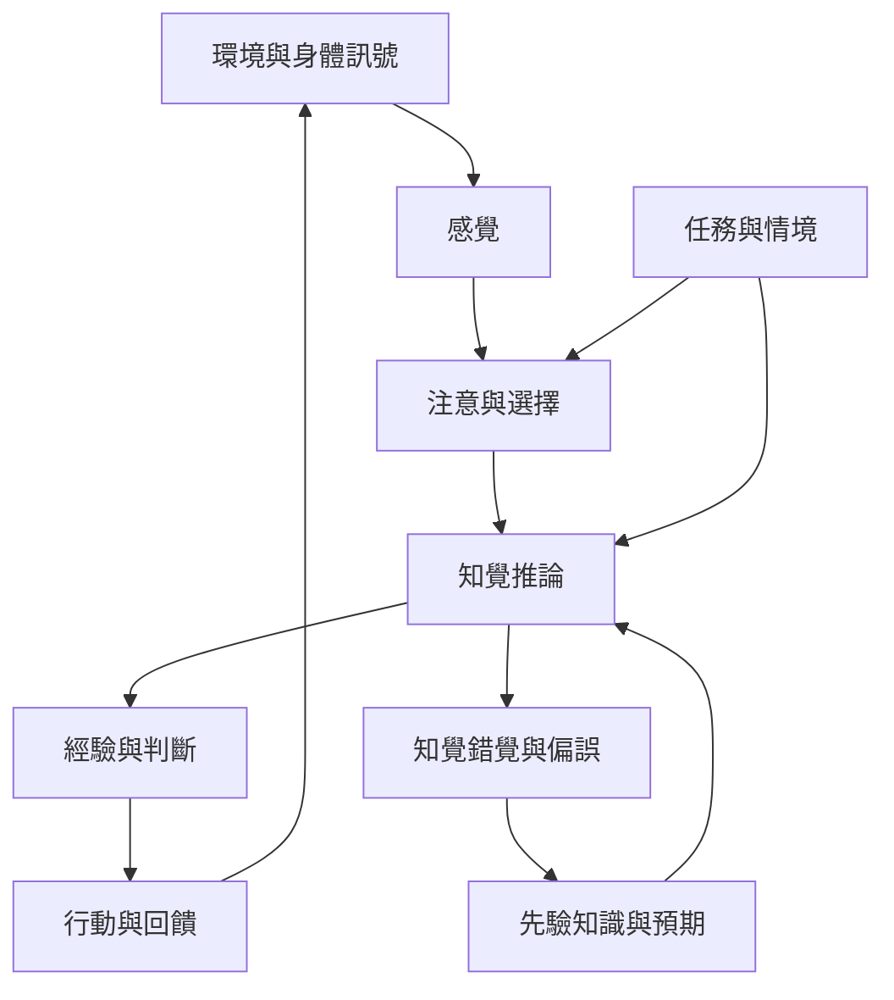

知覺可視為多層次互動：感官系統取得訊號，注意選擇資訊，預期與先驗知識參與推論，環境證據持續限制並修正經驗。錯覺不是例外的奇觀，而是理解這套機制的窗口。不同理論對內在表徵、環境資訊及推論機制的地位有不同看法。

## 參考
* [[知覺是身體與世界持續協調的活動]]、[[預測處理讓知覺成為可修正的推論]]、[[知覺偏誤是有效捷徑的代價]]。
* [[知覺是由預測與感官證據共同校正的經驗]]、[[神經知覺研究應評估推論能力而不只評估訊號忠實度]]、[[錯覺顯示知覺會以先驗假設解讀不完整訊息]]。
* 概念：[[知覺]]、[[感覺]]、[[注意]]、[[預測處理]]、[[預測編碼]]、[[貝葉斯推論]]、[[知覺錯覺]]、[[知覺恆常性]]、[[格式塔心理學]]。
