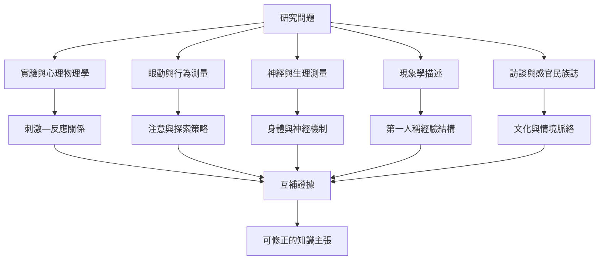

知覺可透過心理物理實驗、眼動追蹤、神經測量、現象學描述、訪談、跨文化比較與感官民族誌研究。不同方法能回答不同問題：實驗適合檢查條件差異，民族誌能理解生活脈絡，現象學描述經驗結構，神經科學研究機制。方法的選擇會決定研究者能看見什麼，也會產生新的盲點。

## 參考
* [[感官民族誌能補足實驗室測量的脈絡]]、[[知覺研究的普遍性必須經過多地區驗證]]、[[知覺的可靠性取決於情境與任務]]。
* [[音樂認知的跨文化研究需要超越西方樣本]]、[[神經知覺研究應評估推論能力而不只評估訊號忠實度]]、[[社會知覺會受到熟悉度與群體分類影響]]。
* 概念：[[心理物理學]]、[[訊號偵測理論]]、[[感官民族誌]]、[[現象學]]、[[文化知覺]]、[[知覺學習]]。
