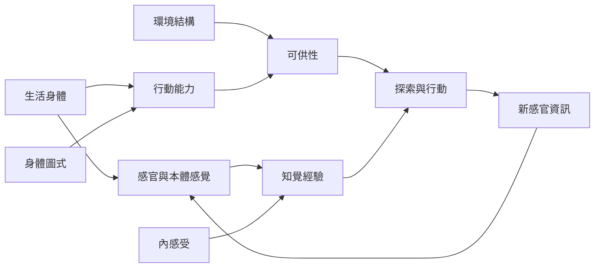

身體不是知覺的外部載體，而是取得資訊、定位、移動與採取行動的條件。生態心理學、現象學、具身認知與行動生成論都重視身體—環境關係，但它們對知覺是否需要內在表徵有不同立場。可供性將環境特徵與行動者能力連接起來，內感受與本體感覺則讓知覺同時涉及外部世界和自身身體。

## 參考
* [[具身知覺使身體成為認識條件]]、[[可供性是環境與行動者能力之間的關係]]、[[主動探索能改善知覺但也改變觀察樣本]]。
* [[吉布森以環境資訊與可供性重新理解視覺]]、[[梅洛龐蒂把知覺理解為身體在世界中的生活]]、[[行動不只是改變輸入也可能構成知覺]]。
* 概念：[[生態心理學]]、[[可供性]]、[[具身認知]]、[[行動生成論]]、[[內感受]]、[[本體感覺]]、[[外感受]]、[[身體圖式]]、[[感覺運動依存關係]]。
