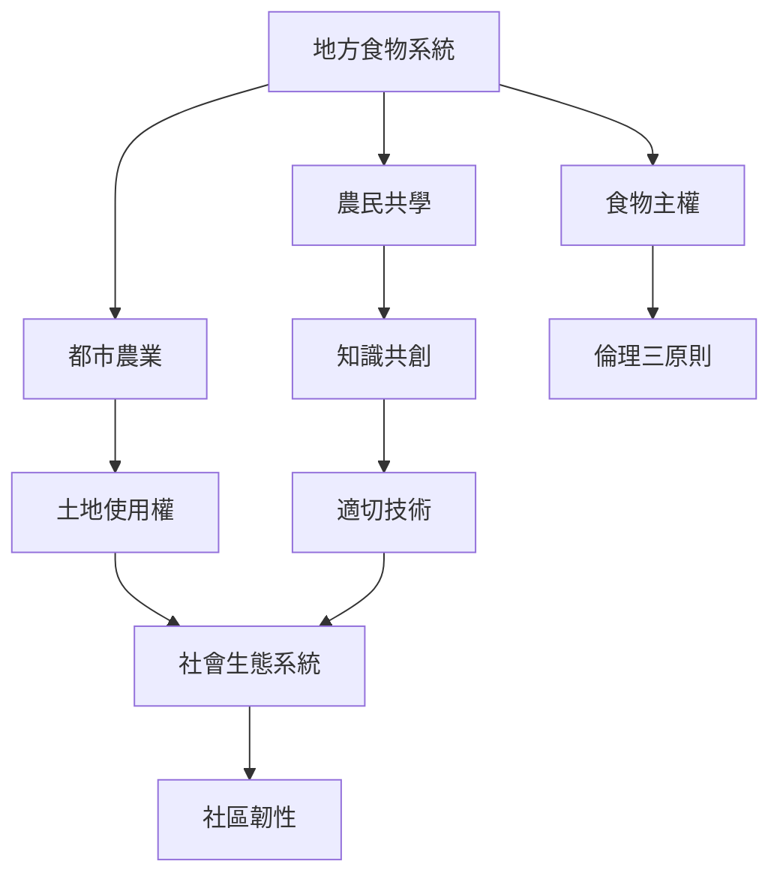

樸門擴展到文化與社會層次時，關鍵不只在生產技術，而是誰擁有土地、誰掌握知識、誰承擔勞動，以及食物如何在生產者與消費者之間流通。農民共學、社區農園、共享餐桌與食物主權可以將農場和日常生活連結起來。

## 思與行
* 把農園、廚房、餐桌、種苗、堆肥和共同決策視為同一個地方食物系統。
* 先建立土地與勞動規則，再談如何增加產量或擴大參與。

## 參考
* [[都市農耕能提升食物自主但需治理土地使用權]]、[[永續農業轉型需要社會組織與制度支持]]、[[永續設計不能忽略勞動成本與土地權利]]
* [[食物主權]]、[[都市農業]]、[[農民共學]]、[[適切技術]]、[[社會生態系統]]、[[原住民族知識]]
