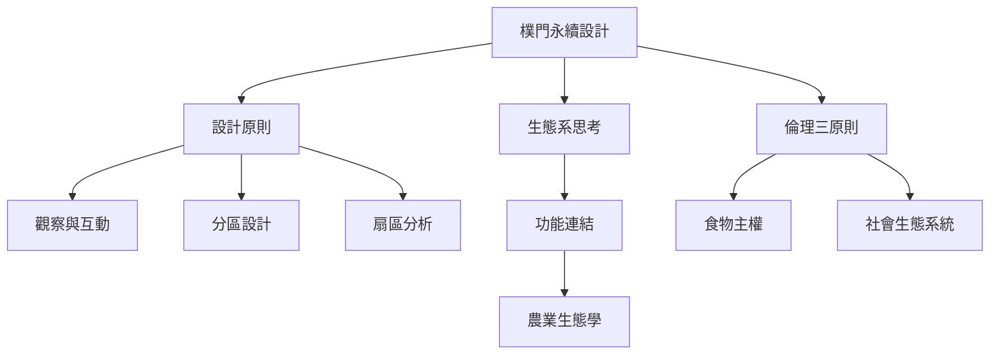

樸門的起點是倫理，接著透過觀察、系統分析與設計原則，將土地、食物、水、能源、居住與社群串成整體。核心爭點是：設計方法如何在不同脈絡中保持開放，同時避免成為模糊而無法驗證的標籤。

## 思與行
* 先讀倫理，再讀設計原則，最後用自己的生活場域做一張需求—產出—限制圖。
* 將此地圖與 [[研究證據與批判視角概念地圖]] 一起閱讀，避免把設計原則當作效果證明。

## 參考
* [[樸門永續設計]]、[[倫理三原則]]、[[設計原則]]、[[生態系思考]]、[[功能連結]]、[[分區設計]]、[[扇區分析]]
* [[樸門是一套設計方法而不是一套固定農法]]、[[永續設計必須同時照顧土地人與剩餘分配]]
