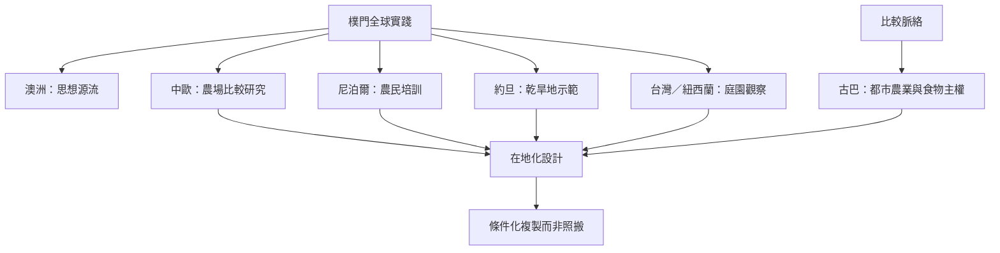

全球案例說明樸門與農業生態實踐會隨地區條件變化。澳洲提供運動的歷史起點；中歐案例提供土壤與生物多樣性比較資料；尼泊爾案例呈現農民培訓與邊緣社群；約旦示範場處理乾旱地水土管理；台灣與紐西蘭的庭園紀錄可作日常資源循環的觀察入口；古巴都市農業則提供食物主權與制度的比較視角，但不是樸門專案。

## 思與行
* 參訪案例時，除了技術，固定記錄氣候、地形、土地制度、勞動、資金和組織條件。
* 將古巴與其他農業生態案例明確標註為比較脈絡，避免誤稱為樸門實證。

## 參考
* [[樸門的起源與歷史受到傳統農業生態學及社會運動多重影響]]、[[尼泊爾案例研究呈現樸門如何與地方文化及農民知識交織]]、[[約旦 Greening the Desert 示範場呈現乾旱地水土整合設計]]
* [[台灣農業知識入口網以紐西蘭庭園紀錄呈現資源循環設計]]、[[古巴都市農業顯示食物自主需要土地制度與社區組織]]、[[當地氣候社會文化決定一個設計能否複製]]
