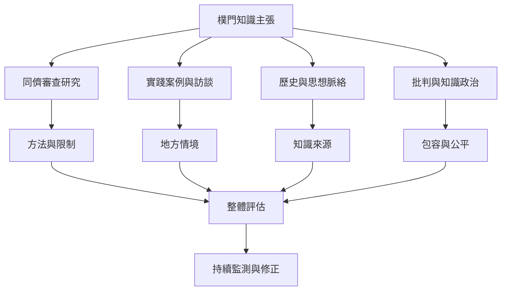

樸門知識庫應同時納入研究、實踐者訪談、機構案例與批判論述，並清楚標示證據類型。比較研究可檢驗土壤與生物多樣性變化；質性訪談能理解地方經驗與定義爭議；去殖民研究則提醒知識來源與權力分配。不同證據回答不同問題，不能互相取代。

## 思與行
* 每項主張標示證據型態、地區、時間、樣本與可外推程度。
* 將生態效益、經濟結果、勞動、公平與知識治理放在同一評估框架中。

## 參考
* [[研究效果時必須區分個案敘事與比較證據]]、[[樸門知識應承認原住民族知識的歷史貢獻]]、[[當地氣候社會文化決定一個設計能否複製]]
* [[樸門永續設計的學術價值在於連結設計方法與農業生態學]]、[[中歐九座樸門農場的比較研究發現土壤與生物多樣性指標較高]]、[[全球南方視角要求樸門運動重新分配知識與代表權]]
