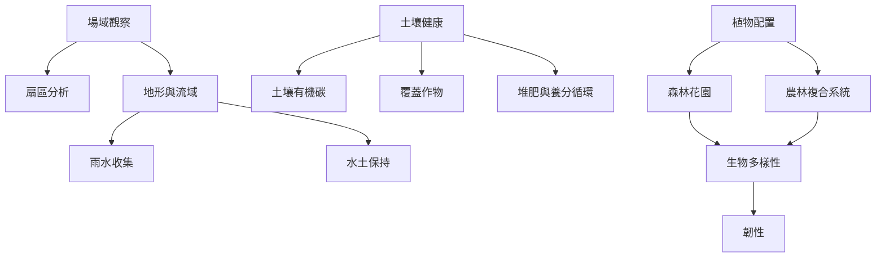

農園的生態生產系統由水、土壤、植物、動物與微生物共同構成。水管理必須先理解場域地形與流域；土壤管理則關注有機碳、結構、覆蓋和生物活動。植物多樣化與農林整合可以增加功能，但需要考慮競爭、維護和轉型期風險。

## 思與行
* 從水流與土壤基線開始，再規劃植物配置與生產層次。
* 任何改造都保留原始狀態與後續監測資料。

## 參考
* [[集水管理應從地形與流域開始]]、[[永續農園的土壤健康必須以長期指標衡量]]、[[多樣性只有形成互補關係才會轉化為韌性]]
* [[雨水收集]]、[[水土保持]]、[[土壤有機碳]]、[[覆蓋作物]]、[[堆肥與養分循環]]、[[森林花園]]、[[農林複合系統]]
