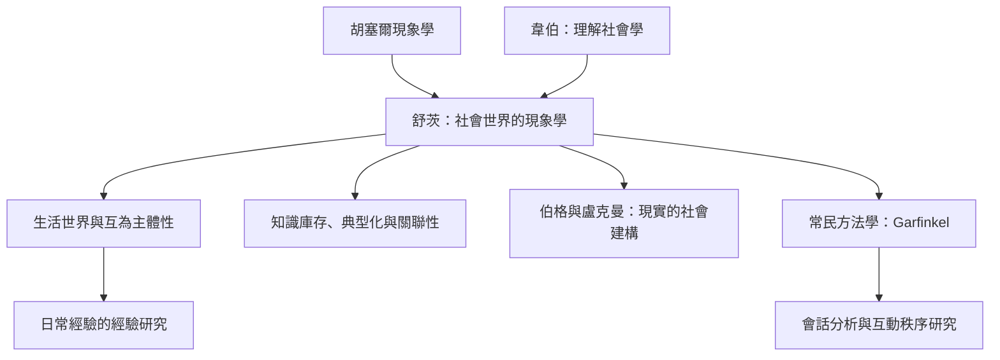

這張概念地圖梳理現象學社會學如何從胡塞爾現象學與韋伯理解社會學交會，經由舒茨的生活世界分析，延伸到盧克曼與伯格的知識社會學，以及常民方法學等相鄰傳統。請注意：圖中箭頭表示思想或問題脈絡，不表示所有學派彼此等同。

## 概念連結
* [[term/現象學社會學研究人們如何經驗並理解社會世界]]、[[term/生活世界是日常行動得以發生的背景]]、[[term/互為主體性使共同世界成為可能]]。
* [[term/知識庫存讓行動者不必每次從零理解世界]]、[[term/典型化讓陌生情境能被快速辨識]]、[[term/關聯性結構決定什麼事物值得注意]]。
* 理論文獻：[[data/舒茨把胡塞爾現象學帶入社會世界的核心工作]]、[[data/《社會世界的現象學》建立理解行動意義的哲學基礎]]、[[data/舒茨與盧克曼把生活世界分析擴展成社會現實理論]]、[[data/《現實的社會建構》說明主觀意義如何沉澱為客觀制度]]、[[data/《常民方法學研究》把日常秩序視為持續完成的成就]]。
