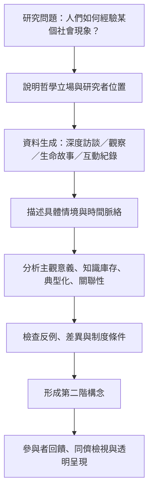

此圖從研究設計出發，呈現如何由具體經驗、訪談與互動觀察，逐步分析行動者的意義、背景知識、關聯性與互動秩序，再形成可檢驗的社會科學構念。不同方法對哲學前提的要求不同，不能把所有質性方法都稱為現象學。

## 概念連結
* 方法概念：[[term/詮釋現象學研究經驗如何被理解而非只被記錄]]、[[term/懸置是反思並暫緩預設的研究態度]]、[[term/第二階構念必須以行動者的第一階理解為基礎]]。
* 分析概念：[[term/行動者的主觀意義是理解社會行動的起點]]、[[term/生平處境限定行動者可用的資源與視野]]、[[term/動機結構連結行動者的過去經驗與未來計畫]]。
* 研究方法來源：[[data/2024年研究重新整理現象學在社會學研究中的用途與限制]]、[[data/弗里茨許策訪談呈現傳記敘事與詮釋社會學]]。
* 實作靈感：[[idea/用一日生活地圖找出被忽略的默會規則]]、[[idea/以生命故事訪談追蹤經驗如何在時間中改變意義]]、[[idea/用微觀互動紀錄檢查社會秩序如何被共同維持]]。
