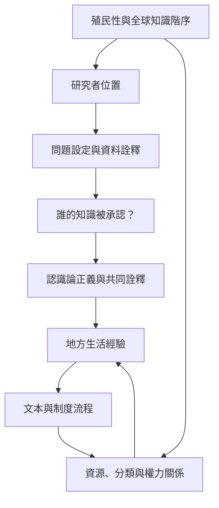

本圖提醒：生活世界不是封閉的微觀領域。日常經驗會與政策、文本、制度、殖民歷史及學術知識生產交織。現象學社會學若要回應當代不平等，需要把描述工作連接到研究者位置、知識授權與制度分析。

## 概念連結
* [[term/知識位置影響什麼能被看見與被相信]]、[[term/認識論正義要求不同群體能成為知識主體]]、[[term/制度性文本把地方行動連接到跨地方支配關係]]。
* 拉丁美洲思想：[[term/解放哲學從被壓迫者的歷史處境批判知識依賴]]、[[data/拉丁美洲解放哲學從歷史處境出發反思知識依賴]]。
* 全球南方與批判：[[data/全球南方研究者以生活經驗挑戰知識生產階序]]、[[data/社會學知識生產需要檢查殖民性與制度權力]]。
* 制度研究：[[data/多蘿西史密斯從女性立場出發研究日常世界與支配關係]]、[[data/南非研究以單一生活世界理解後種族隔離時代的轉型]]。
* 實踐靈感：[[idea/讓社群共同詮釋生活世界而非只提供研究資料]]、[[idea/追蹤一份表單如何把地方生活連接到制度]]、[[idea/把研究者的熟悉感當成需要反思的資料]]。
