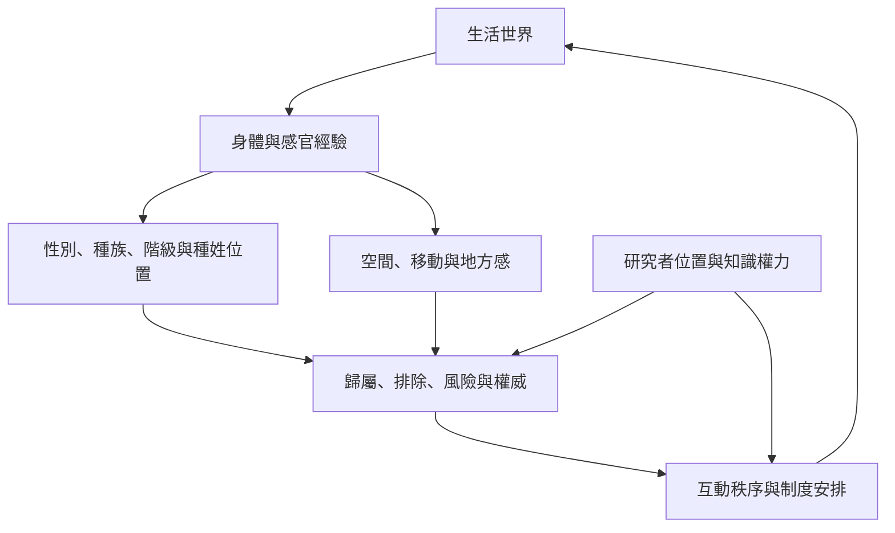

這張地圖將現象學社會學的生活世界分析與女性主義身體現象學、批判種族現象學、印度種姓研究及地方感研究連接。這些傳統彼此可對話，但理論來源、政治脈絡與研究對象各有差異。

## 概念連結
* [[term/具身經驗讓權力以感官與空間方式被感受]]、[[term/生活經驗總是位於特定社會位置]]、[[term/地方感是身體經驗與集體意義交織的結果]]。
* 印度案例：[[data/印度研究以種姓的感官經驗重新思考日常社會]]、[[data/印度種姓日常經驗研究展示多種經驗敘事方法]]、[[data/Gopal Guru在對談中把種姓描述為持續經驗的社會現實]]。
* 拉丁美洲脈絡：[[data/巴西研究以舒茨社會現象學理解無家女性的生活經驗]]、[[data/拉丁美洲解放哲學從歷史處境出發反思知識依賴]]。
* 南非與非洲脈絡：[[data/南非研究以單一生活世界理解後種族隔離時代的轉型]]、[[data/法農以殖民種族化經驗發展非洲現象學批判]]、[[data/亞伯拉罕奧利維耶在訪談中反思非洲現象學與流離]]。
* 身體與性別：[[data/艾里斯楊以女性身體經驗分析性別化空間]]。
* 研究實踐：[[idea/以感官散步記錄地方如何組織社會關係]]、[[idea/建立位置比較矩陣避免把單一經驗當成普遍經驗]]。
