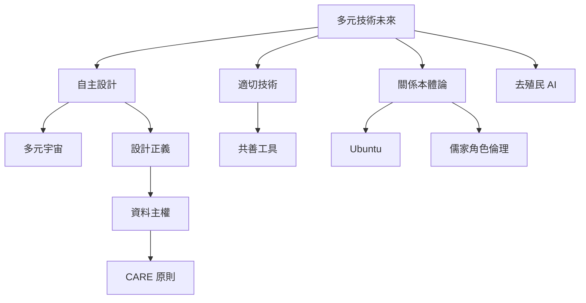

去殖民技術哲學不把地方思想當作補充案例，而是讓它們參與重寫問題本身。自主設計、多元宇宙、Ubuntu、儒家角色倫理和原住民族資料主權，提供不同的關係、共同體、地方適切性與知識治理資源。這些脈絡彼此不相同，應在對話中保留差異。

## 概念關係圖

## 概念連結
[[自主設計]]、[[多元宇宙]]、[[適切技術]]、[[共善工具]]、[[關係本體論]]、[[Ubuntu]]、[[儒家角色倫理]]、[[設計正義]]、[[資料主權]]、[[CARE 原則]]

## 永久筆記
* [[多元技術未來必須由地方脈絡與社群自主共同塑造]]
* [[跨文化技術倫理不能把地方思想簡化成文化裝飾]]
* [[知識共享不等於取消知識主體的治理權]]
* [[技術正義要求受影響社群成為知識與設計主體]]

[[Philosophy_of_technology]]
