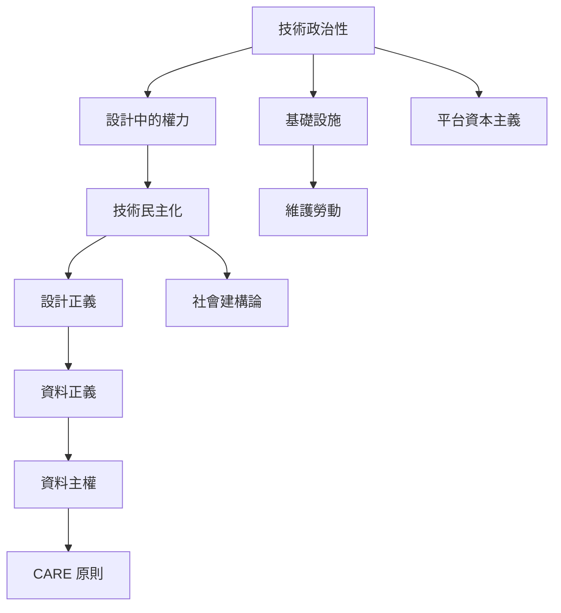

技術系統不是社會之外的中性事物，而會把權力關係固定在設計、標準、分類與基礎設施中。治理的核心問題因此不只是如何防止個別濫用，更是誰有權定義技術方向、如何分配利益和風險，以及受影響群體能否改變設計。

## 概念關係圖

## 概念連結
[[技術政治性]]、[[基礎設施]]、[[技術基礎設施研究]]、[[維護勞動]]、[[技術民主化]]、[[設計正義]]、[[資料正義]]、[[資料主權]]、[[CARE 原則]]、[[平台資本主義]]

## 永久筆記
* [[技術不是中性工具，設計會把價值與權力寫進物件]]
* [[技術民主化要求受影響者參與設計與治理]]
* [[資料治理必須保障集體利益與原住民族的控制權]]
* [[技術基礎設施研究必須看見隱形維護工作]]

[[Philosophy_of_technology]]
