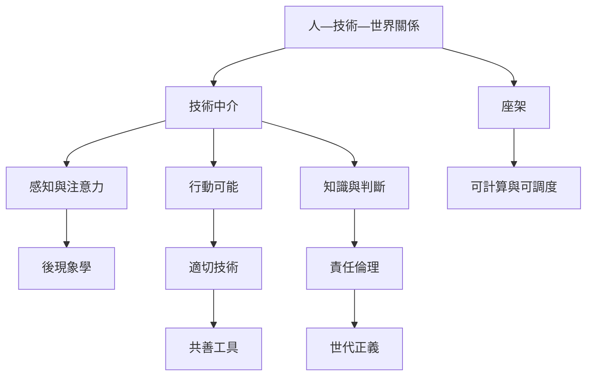

從後現象學看，技術不只是外在工具，而是改變人如何感知、理解和行動的中介。從海德格的座架批判到日常技術經驗的細緻分析，兩者可互相校正：前者提醒我們辨認現代技術的支配性世界觀，後者避免忽略具體技術在不同情境中的差異。

## 概念關係圖

## 概念連結
[[技術中介]]、[[後現象學]]、[[座架]]、[[適切技術]]、[[共善工具]]、[[責任倫理]]、[[世代正義]]

## 永久筆記
* [[技術中介會同時擴展與收窄人的感知與行動]]
* [[海德格指出現代技術會把世界揭示為可計算與調度的資源]]
* [[技術時代的倫理必須承擔遠方後代與生態系的責任]]

[[Philosophy_of_technology]]
