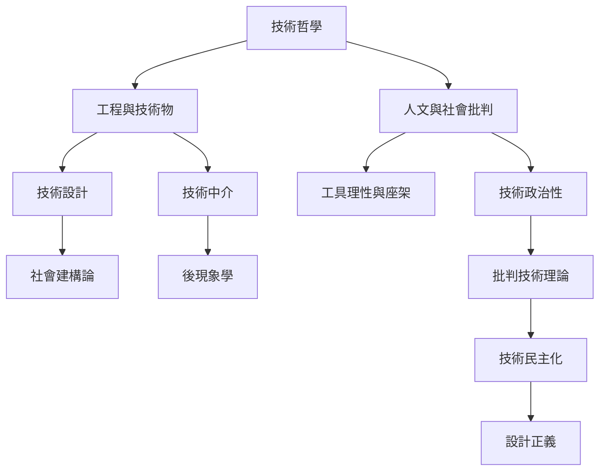

技術哲學不是單一學派，而是多種問題意識的交會：技術究竟是工具、知識形式、世界揭示方式，還是塑造社會關係的制度力量？思想史從機械與工業現代性批判，延伸到工程哲學、社會建構、後現象學和技術倫理。閱讀時可在宏觀理論與具體案例之間來回移動。

## 概念關係圖

## 概念連結
[[技術哲學]]、[[技術]]、[[工具理性]]、[[技術中介]]、[[後現象學]]、[[座架]]、[[社會建構論]]、[[技術政治性]]、[[批判技術理論]]、[[技術民主化]]、[[設計正義]]

## 永久筆記
* [[技術哲學同時研究技術本身與技術的社會意義]]
* [[技術決定論會遮蔽技術發展中的政治選擇]]
* [[技術分析必須從具體設計與使用情境出發]]

[[Philosophy_of_technology]]
