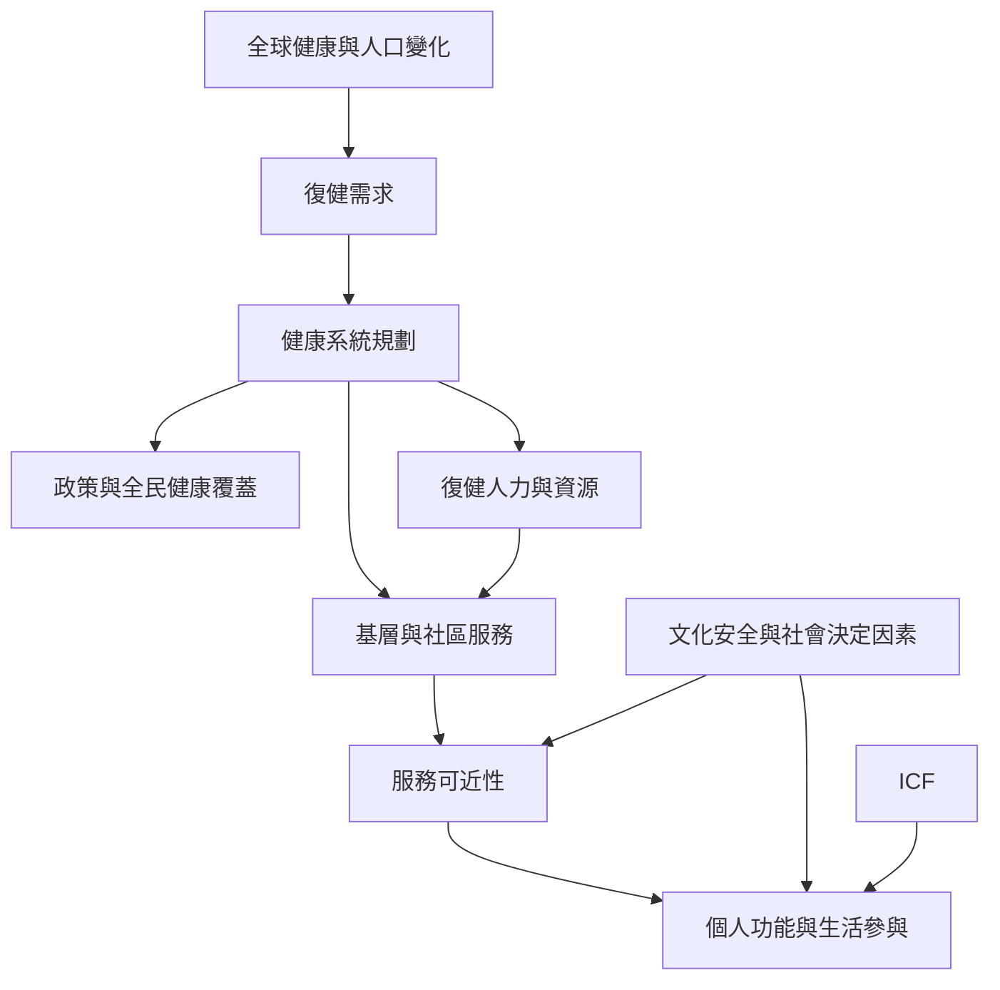

本圖把物理治療放回全球復健與健康系統：疾病負擔形成需求，制度與人力影響服務供給，基層與社區場域影響可近性，ICF 則協助把功能成果連回生活參與。跨國資料必須保留地區差異，不能只用全球平均推論地方經驗。

**閱讀提示：** 從 [[全球約有二十四億人可能在疾病或傷害過程中受益於復健]] 開始，再讀 [[Rehabilitation 2030 將復健定位為健康系統的核心能力]]、[[基層與社區是復健可近性的關鍵場域]] 與 [[復健不平等是健康系統問題]]。地區案例可對讀 [[巴西基層照護資料顯示物理治療可兼具臨床照護與健康促進]]、[[南非研究指出物理治療進入基層照護必須處理人力與專業階層]]、[[尼泊爾復健服務調查呈現物理治療發展與城鄉可近性挑戰並存]]。

## 思與行
* 以台灣一個行政區作為案例，繪出需求、資源、轉介、交通與服務缺口。

## 參考
* [[復健是全民健康照護而非少數人的補救服務]]、[[世界物理治療組織以五大區域呈現專業協會的全球多樣性]]、[[基層健康照護]]、[[全民健康覆蓋]]、[[社區復健]]。
