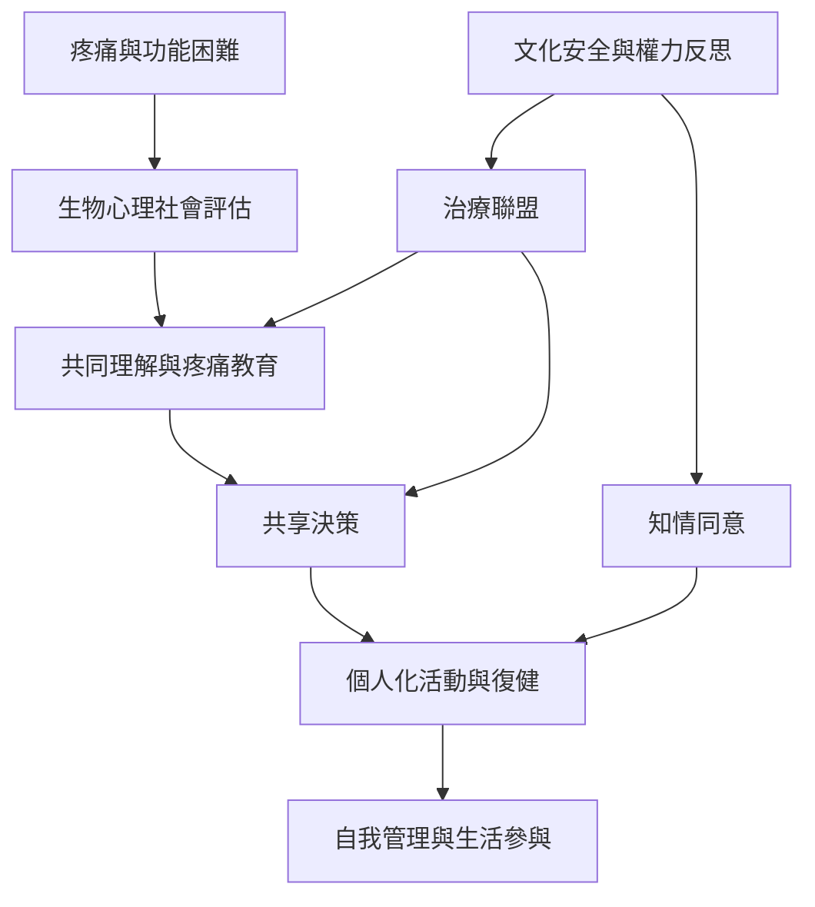

慢性疼痛照護不只涉及疼痛機制與運動介入，也包括患者如何理解疼痛、是否感到被尊重，以及如何參與決策。疼痛教育、生物心理社會模型與治療聯盟共同支撐個人化復健；知情同意與文化安全則界定身體接觸和專業權力的倫理邊界。

**閱讀提示：** 比較 [[下背痛患者把傾聽解釋與個人化策略視為治療關係的重要部分]]、[[慢性疼痛患者重視治療者理解整個人的經驗而不只處理身體部位]] 與澳洲原住民族照護研究，注意研究設計和受訪者背景的差異。

## 思與行
* 審視一段治療溝通是否同時包含理解、選擇、同意與退出的空間。

## 參考
* [[慢性疼痛需要生物心理社會取向而非單一組織修復模型]]、[[治療關係會影響患者的參與與自我管理]]、[[文化安全需要分享權力而不只是學習文化知識]]、[[徒手接觸必須建立在知情同意上]]。
