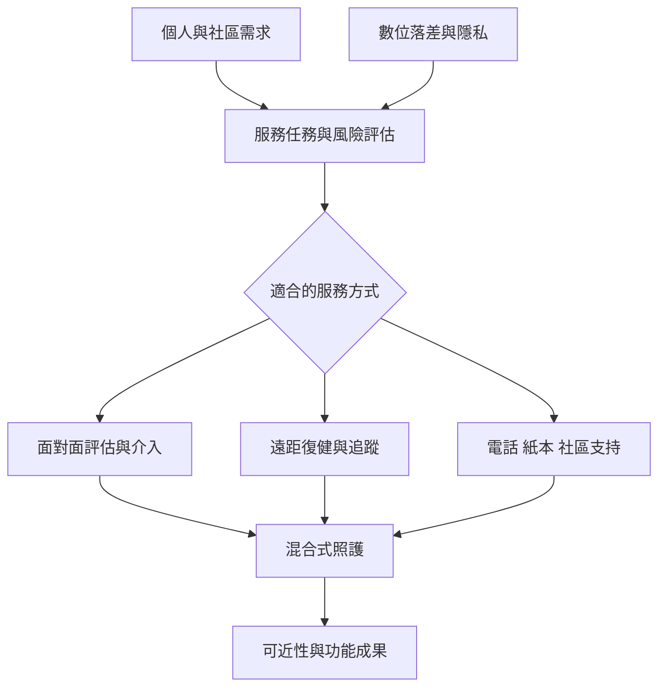

未來復健可能同時使用面對面照護、遠距追蹤、社區據點與居家活動。科技的價值不在於越複雜越好，而在於能否補足人力與地理限制，並且不排除設備、網路或數位素養不足的人。

**閱讀提示：** 從 [[遠距復健應補足服務而非假設可全面取代面對面照護]] 出發，延伸至 [[復健不平等是健康系統問題]] 與 [[建立遠距與面對面互補的低科技復健模式]]。

## 思與行
* 評估科技是否真正降低了患者成本，還是把設備、時間與隱私責任轉嫁給患者及家屬。

## 參考
* [[遠距復健可擴大部分服務可近性但不宜一概視為面對面照護替代品]]、[[數位落差]]、[[遠距復健]]、[[可近性]]。
