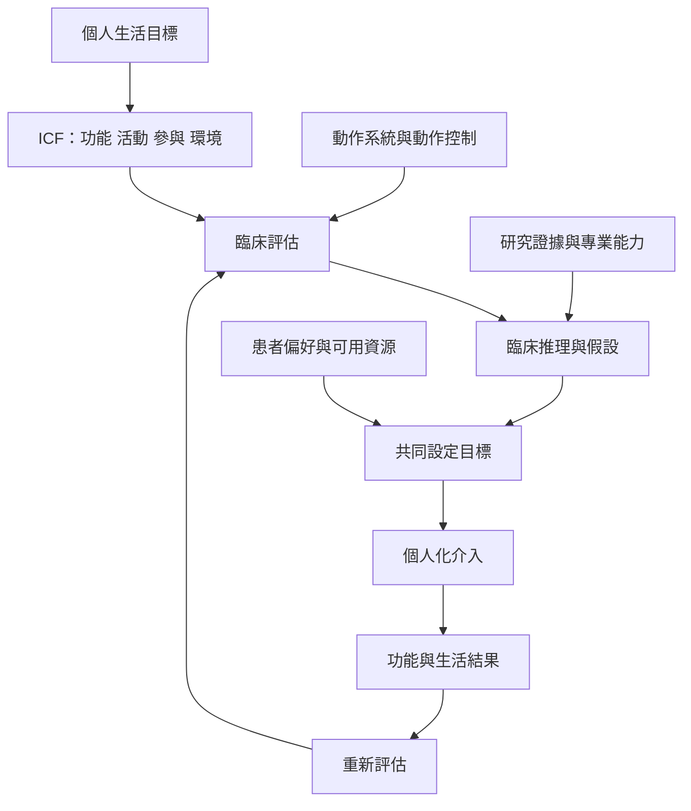

本圖整理從個人目標到評估、臨床推理、介入和成果追蹤的循環。ICF 提供跨層次描述，動作系統與動作控制協助理解身體如何完成任務；治療性運動則應透過共享決策與個人情境調整。

**閱讀提示：** 先讀 [[復健的主要成果是讓人重新參與自己重視的生活]] 與 [[功能與生活參與比疾病標籤更能描述復健目標]]，再讀 [[運動處方必須符合個人情境與偏好]]、[[實證實踐不是把研究結果當成固定處方]]。

## 思與行
* 用一個不涉及個人醫療建議的假想案例，練習把身體指標轉成生活目標，並標記環境因素。

## 參考
* [[WHO 的 ICF 架構讓復健同時觀察身體活動與環境條件]]、[[物理治療的動作系統觀點把多個生理系統視為協作整體]]、[[ICF]]、[[動作控制]]、[[運動處方]]、[[臨床推理]]。
