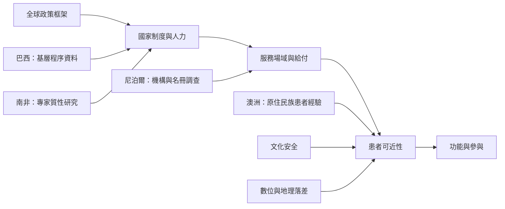

本圖將不同地區研究視為制度情境案例，而不是將國家當成固定類型。巴西呈現基層服務程序，南非呈現專業與政策整合挑戰，尼泊爾呈現服務分布與偏遠地區可近性，澳洲原住民族研究則聚焦文化安全。比較時應保留方法差異。

**閱讀提示：** 對照 [[物理治療必須依照在地制度與文化調整]] 與 [[復健不平等是健康系統問題]]，再回到每項研究的原始方法，不要把質性研究、行政資料與機構調查混為同一種證據。

## 思與行
* 建立跨地區比較矩陣，欄位至少包含資料年份、研究設計、場域、受訪者／資料來源、服務供給與限制。

## 參考
* [[巴西基層照護資料顯示物理治療可兼具臨床照護與健康促進]]、[[南非研究指出物理治療進入基層照護必須處理人力與專業階層]]、[[尼泊爾復健服務調查呈現物理治療發展與城鄉可近性挑戰並存]]、[[澳洲原住民族患者以關係建立與文化尊重描述安全的物理治療]]。
