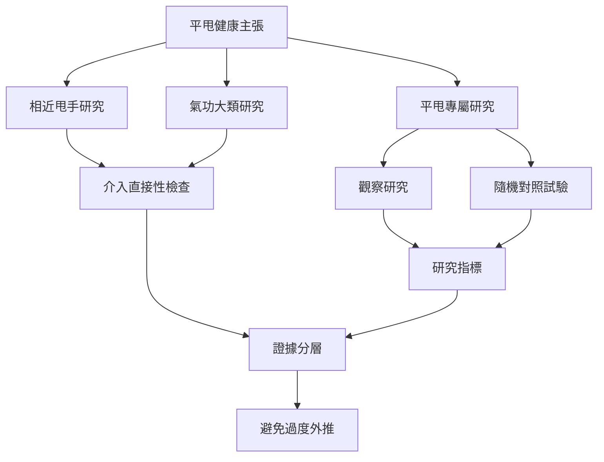

本地圖將平甩專屬研究、相近甩手功研究與氣功大類研究分層，並將研究設計與測量指標放在同一脈絡中。核心問題不是「氣功有沒有用」，而是「哪一種動作、對哪一群人、在什麼條件下，對哪些結果產生多大變化」。

概念連結：[[隨機對照試驗]]、[[叢集隨機分派]]、[[研究指標]]、[[證據分層]]、[[相關與因果]]、[[傳統知識與現代實證研究]]、[[睡眠品質]]、[[更年期症狀]]。

核心研究：[[台灣更年期婦女研究觀察到十二週平甩方案與睡眠及症狀改善相關]]、[[泰國高齡女性甩手功試驗提供姿勢柔軟度步態等功能改善的初步證據]]、[[美國NCCIH指出氣功研究有潛力但高齡族群證據仍有限]]。

靈感延伸：[[以多個社區和活性對照設計下一代甩手功研究]]、[[建立平甩健康主張的證據分層標籤]]。
