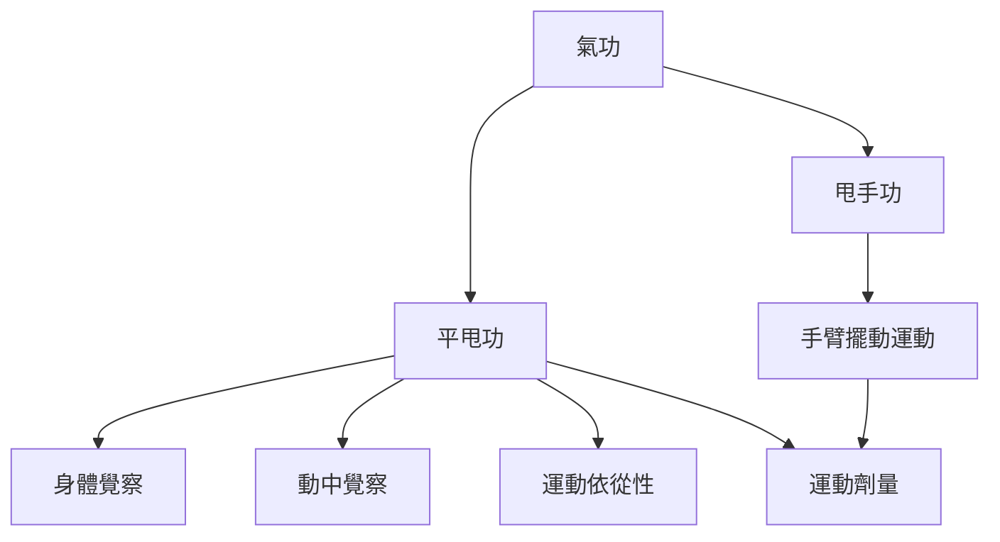

本地圖整理平甩功、傳統甩手功與手臂擺動運動之間的名稱與動作層級，並連結身體覺察、動中覺察及運動依從性。閱讀時先釐清動作版本，再討論練習意義與持續條件。

概念連結：[[氣功]]、[[平甩功]]、[[甩手功]]、[[手臂擺動運動]]、[[動中覺察]]、[[身體覺察]]、[[運動依從性]]、[[運動劑量]]。

相關筆記：[[平甩功的低門檻與重複節律使它適合成為日常身體練習]]、[[平甩功與一般甩手運動必須依動作策略分開描述]]、[[身體覺察讓重複動作成為可觀察的經驗而不只是計數]]。

靈感延伸：[[以八週練習日誌觀察平甩如何進入日常生活]]、[[製作平甩動作版本卡讓不同教學不再混淆]]。
