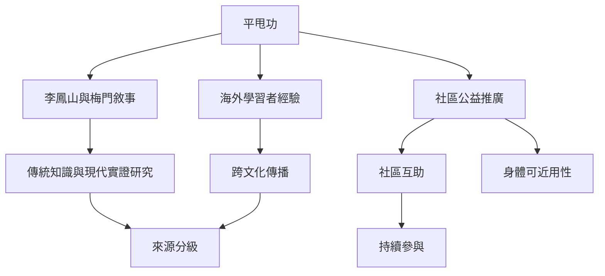

本地圖把平甩功視為一種同時具有身體技術、傳承敘事、跨文化翻譯與社區組織的實踐。歷史說法需與可追溯文獻分層，社群價值則可獨立於醫療療效評估。

概念連結：[[平甩功]]、[[傳統知識與現代實證研究]]、[[社區互助]]、[[身體可近用性]]、[[證據分層]]。

資料筆記：[[李鳳山在訪談中將平甩功描述為融合武術與儒釋道思想的普傳方法]]、[[海外學習者把平甩功體驗為動中覺察與身體放鬆]]、[[台灣平甩公益活動將練習擴展到長者身障者與海外社群]]。

靈感延伸：[[以訪談記錄不同文化中的平甩練習語言]]、[[開辦不承諾療效的社區平甩共修]]。
