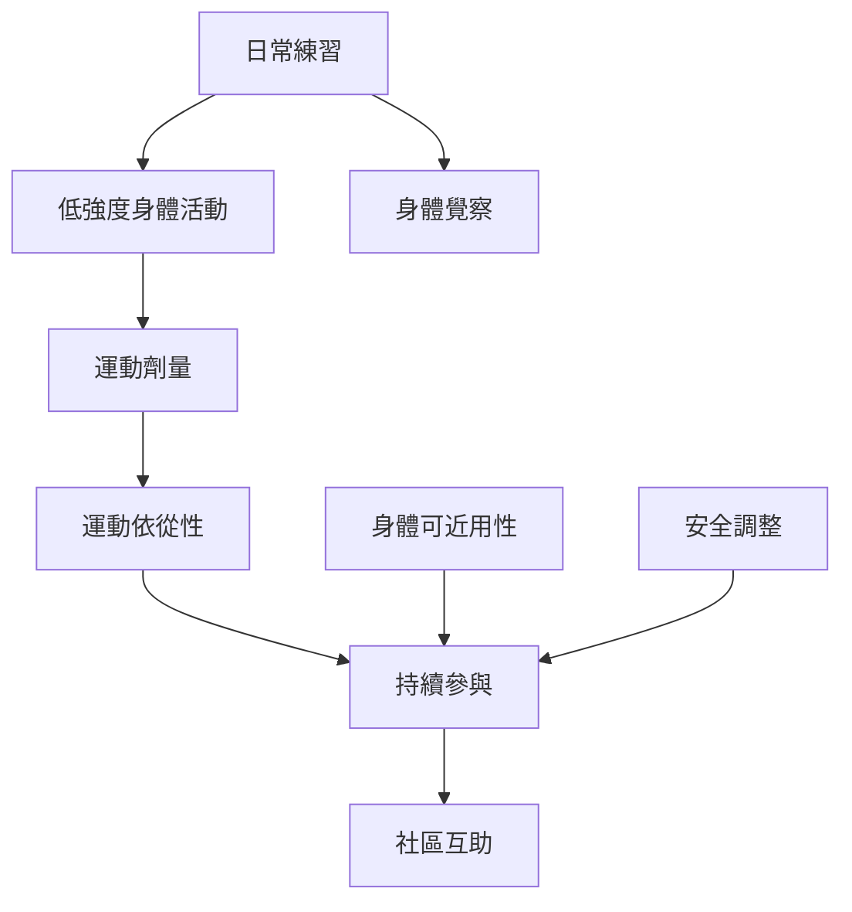

本地圖聚焦平甩功如何在日常生活中成為可持續的身體活動，並透過團練與公益推廣形成社群關係。它把低門檻、練習劑量、安全調整與身體覺察連起來。

概念連結：[[低強度身體活動]]、[[運動劑量]]、[[運動依從性]]、[[身體覺察]]、[[身體可近用性]]、[[社區互助]]。

永久筆記：[[平甩功的低門檻與重複節律使它適合成為日常身體練習]]、[[低強度不等於零風險]]、[[平甩公益推廣把個人運動轉化為社區互助的機會]]。

靈感延伸：[[以八週練習日誌觀察平甩如何進入日常生活]]、[[用小幅度與坐姿替代版本提高平甩的可近用性]]。
