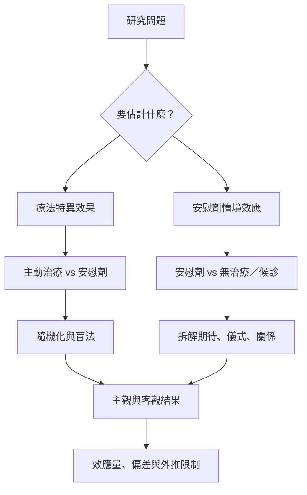

安慰劑研究的關鍵方法問題，是比較組能否回答研究者提出的因果問題。[[安慰劑對照試驗]] 通常比較特異治療成分與安慰劑條件；若要估計完整安慰劑反應中有多少來自情境與期待，還需考慮 [[自然病程]]、[[回歸平均值]]、無治療組、測量偏差及結果選擇。

與 [[安慰劑反應不等於安慰劑效應]]、[[安慰劑研究需要同時測量患者感受功能與客觀健康指標]] 一起閱讀。

全書導讀：[[Placebo]]
