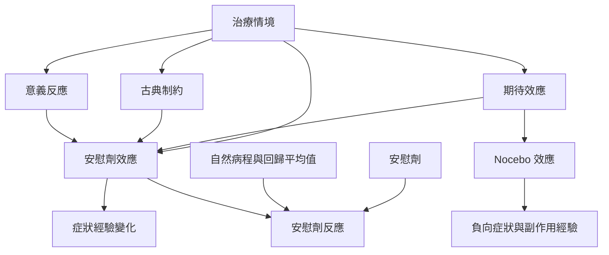

安慰劑研究的核心問題，是如何從治療物質的特異作用中，辨識治療情境、期待、學習與關係帶來的結果變化。需先拆分 [[安慰劑]]、[[安慰劑效應]] 與 [[安慰劑反應]]，再理解其與 [[Nocebo 效應]] 的對照關係。

可沿著 [[安慰劑效應]] → [[期待效應]]／[[古典制約]] → [[安慰劑止痛可招募內源性鴉片系統但不是所有療效的通用解釋]] 的路徑閱讀。

全書導讀：[[Placebo]]
