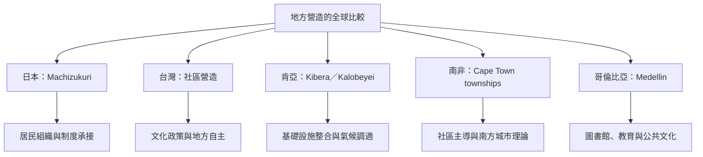

不同地區的地方營造由不同歷史制度與生活條件塑造。日本 Machizukuri 顯示居民運動如何逐步形成制度；台灣社區營造連結文化政策與地方自主；肯亞與南非案例凸顯非正式聚落、基礎設施及社區主導；哥倫比亞麥德林則展示文化設施如何成為社會城市政策的一部分。

比較時不要複製外觀形式，而要比較：土地權利、政府角色、居民組織、資金來源、使用者構成、維護方式與歷史衝突。

案例來源：[[data/日本まちづくり由居民倡議逐步發展成社區管理體系]]、[[data/台灣社區營造從社區發展走向居民自主與文化政策]]、[[data/肯亞Kibera與卡洛貝耶的公共空間可以同時改善基礎設施與社會連結]]、[[data/南非開普敦的社區主導地方營造挑戰了由上而下規劃]]、[[data/麥德林圖書館公園將文化教育休閒與城市社會政策結合]]。
