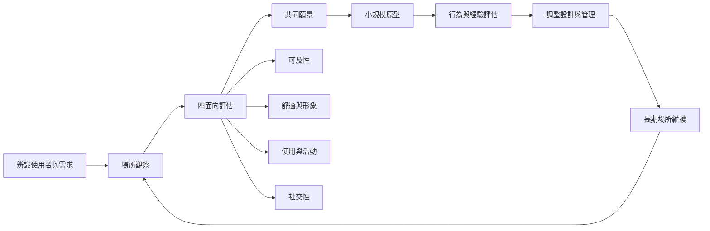

公共空間的地方營造應先理解實際生活，再提出介入。PPS 四面向協助共同觀察品質，Whyte 與 Gehl 提供行為觀察方法，戰術都市主義則能把假設轉成可逆原型；評估結果再回到設計及治理。

延伸閱讀：[[公共空間]]、[[公共生活研究]]、[[戰術都市主義]]、[[步行性]]、[[混合使用]]、[[場所維護]]、[[社會基礎設施]]。

實務依據：[[data/公共空間品質可由連結性舒適活動與社交四面向評估]]、[[data/William_Whyte以現場觀察揭示公共空間如何被使用]]、[[data/公共生活研究應以觀察而非設計者直覺評估空間]]。
