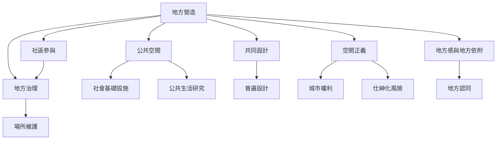

地方營造是一個交會於空間、經驗、參與和治理的實踐。它從地方感與地方依附理解人與場所的關係，透過共同設計及社區參與把使用者知識帶入決策，並以公共空間和場所維護承載長期生活。若缺乏空間正義，地方營造也可能成為排除或仕紳化的工具。

延伸閱讀：[[地方營造]]、[[地方感]]、[[地方依附]]、[[公共空間]]、[[共同設計]]、[[社區參與]]、[[地方治理]]、[[場所維護]]、[[空間正義]]、[[城市權利]]。

案例依據：[[data/社區居民應參與地方營造的定義與決策而不只是被諮詢]]、[[data/日本まちづくり由居民倡議逐步發展成社區管理體系]]、[[data/台灣社區營造從社區發展走向居民自主與文化政策]]。
