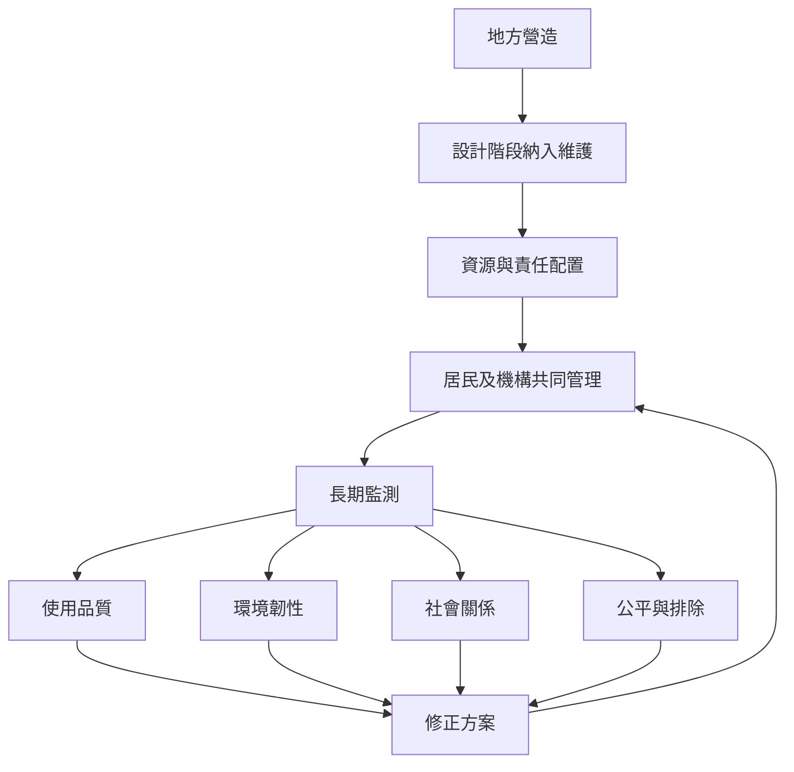

地方營造需要從一次性工程走向長期照護。場所維護將空間設施、社會關係、環境韌性與治理責任連結起來；評估則要持續觀察使用經驗、公共性與利益分配。

延伸閱讀：[[場所維護]]、[[地方治理]]、[[氣候韌性]]、[[公共生活研究]]、[[空間正義]]。

研究依據：[[data/地方營造與氣候調適必須把遮蔭降溫排水與公平納入設計]]、[[data/公共生活研究應以觀察而非設計者直覺評估空間]]、[[data/2026年全球兒童公共空間指南將安全遊戲可及公平與永續整合]]。
