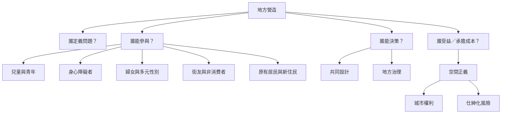

地方營造若要民主且包容，必須同時處理不同群體的生活經驗、實際決策權、使用規則與空間利益分配。參與式程序本身不保證公平；需要檢視誰被邀請、誰能發言、誰能改變決策，以及誰在空間更新後失去位置。

延伸閱讀：[[空間正義]]、[[城市權利]]、[[共同設計]]、[[社區參與]]、[[普遍設計]]、[[交織性]]、[[仕紳化]]、[[地方品牌化]]。

研究依據：[[data/批判性地方營造將公共空間重新連結到民主與社會正義]]、[[data/身心障礙者共同設計公共建成環境需要持續且有權力的參與]]、[[data/性別友善公共空間必須同時考慮安全感可讀性與空間使用權]]、[[data/多倫多Bentway案提醒基礎設施再利用可能改變弱勢者的生存空間]]。
