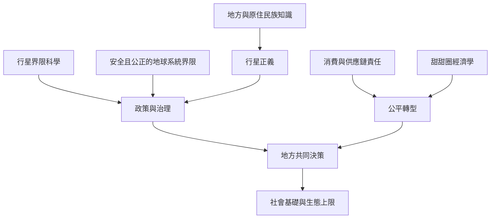

行星界限提供地球系統科學上的安全護欄，但要落實為公共決策，仍需解決責任分配、民主正當性、區域尺度與知識多元性。安全且公正的地球系統界限、行星正義與甜甜圈經濟學，分別從生態風險、人類免受傷害、不同世界觀的承認及社會繁榮目標補足治理框架。

## 概念地圖

## 思與行
* 每次政策討論都問：誰定義問題、誰能參與、誰受益、誰承擔風險、誰的知識被排除？
* 將全球界限轉成地方行動時，建立公開資料與社群共同決策，而非只下達抽象目標。

## 參考
* [[安全且公正的地球系統界限把生態穩定與人類免受傷害放在一起]]；[[行星界限的科學權威需要民主正當性與知識多元性]]。
* [[繁榮應被定義為滿足所有人的需求且不超越生態上限]]；[[原住民族知識不是待補充的資料而是治理世界的知識體系]]。
* 概念：[[Earth_system_boundaries|安全且公正的地球系統界限]]、[[Planetary_justice|行星正義]]、[[Doughnut_economics|甜甜圈經濟學]]。
