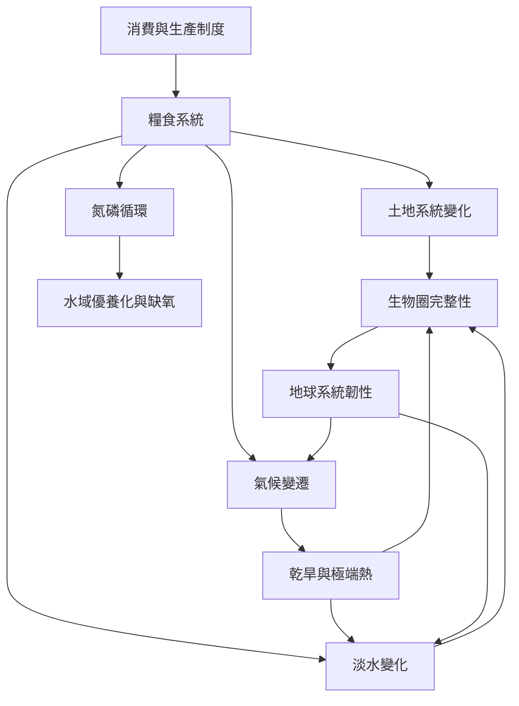

這張概念地圖聚焦於地球系統界限之間的因果連結。氣候與生物圈是核心過程，土地利用和糧食系統則是人類活動連接氣候、水與營養循環的重要節點。改善一個環節可能帶來共同效益，也可能因政策設計不當把壓力轉移到其他界限。

## 概念地圖

## 思與行
* 使用食物系統案例，從生產端追到消費、剩食和公平取得，練習跨界限思考。
* 優先找出能同時改善多項界限的政策組合，而非追求單一指標最優化。

## 參考
* [[全球糧食系統同時推動多項行星界限超越]]；[[糧食系統是連接土地淡水氣候與營養循環的關鍵槓桿]]。
* 概念：[[Food_system|糧食系統]]、[[Biogeochemical_flows|生物地球化學流]]、[[Freshwater_change|淡水變化]]、[[Biosphere_integrity|生物圈完整性]]。
