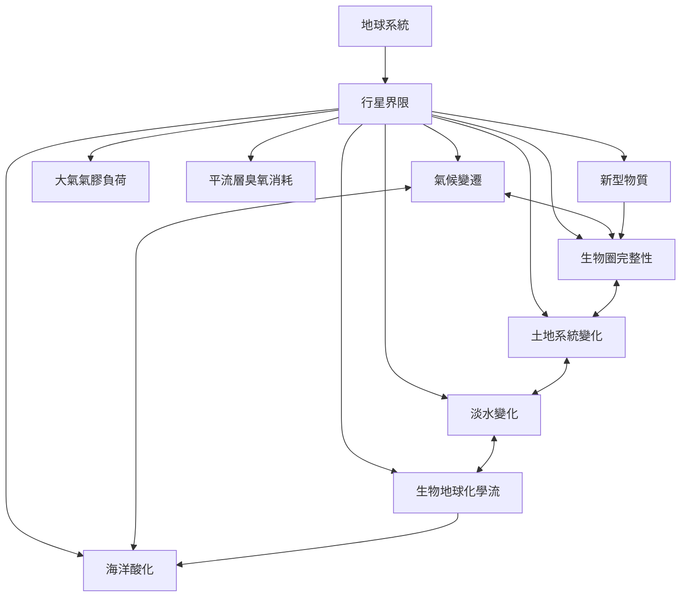

行星界限將地球系統中九項彼此作用的關鍵過程，整理成理解人類活動風險的整體框架。它不是單一環境問題清單，而是讓氣候、生物圈、土地、水、營養循環、海洋、空氣與新型物質互相對照。2026 年評估顯示七項界限已被超越；判讀時仍需區分全球狀態、區域差異與每項指標的不確定性。

## 概念地圖

## 思與行
* 先理解九項界限，再沿著案例追蹤它們如何互相放大。
* 以[[安全操作空間必須同時回答誰承擔風險與誰享有資源]]補充生物物理框架中的公平問題。

## 參考
* [[2026 年地球健康檢查指出九項行星界限已有七項遭到超越]]；[[九項行星界限描述彼此互動的地球系統關鍵過程]]。
* 概念：[[Planetary_boundaries|行星界限]]、[[Earth_system|地球系統]]、[[Safe_operating_space|安全操作空間]]。
