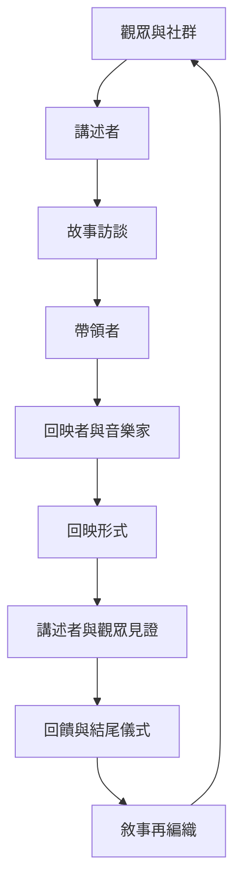

Playback Theatre 由講述者提供故事，帶領者透過故事訪談協助聚焦，回映者與音樂家以即興形式回應，團隊再以回饋與結尾儀式完成一次共同見證。流程清楚，但每次內容都由當下的人與關係生成。

主要概念：[[Playback Theatre]]、[[講述者]]、[[帶領者]]、[[回映者]]、[[劇團合奏]]、[[故事訪談]]、[[回映形式]]、[[流動雕塑]]、[[雙人形式]]、[[合唱形式]]、[[敘事再編織]]。
