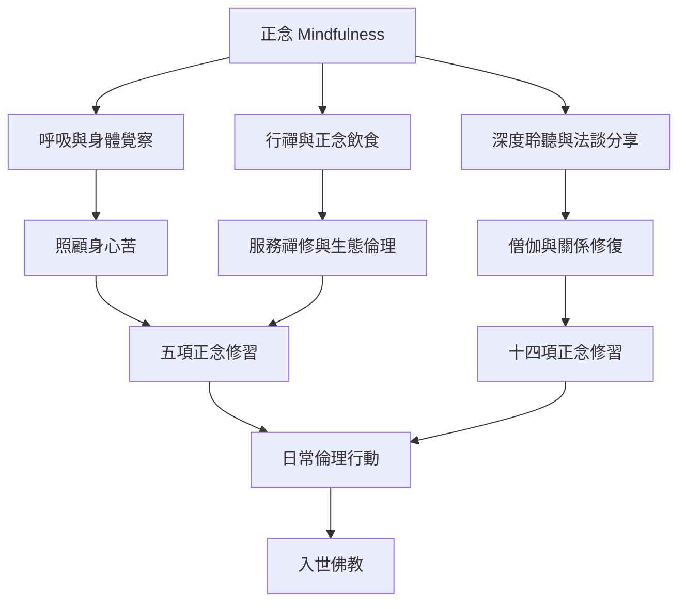

梅村的修習系統可理解為「覺察—倫理—生活—共同體」的互相支持：正念提供看見當下的能力，五項與十四項正念修習把看見轉成倫理行動，日常活動提供練習場，僧伽則提供支持與共同校正。這套系統不應被簡化為單一冥想技術。

這張圖可與[[全球僧團與地方共修網絡概念地圖]]、[[入世佛教與生態倫理概念地圖]]互相閱讀。相關概念：[[正念]]、[[五項正念修習]]、[[十四項正念修習]]、[[行禪]]、[[正念飲食]]、[[深度聆聽]]、[[服務禪修]]。
