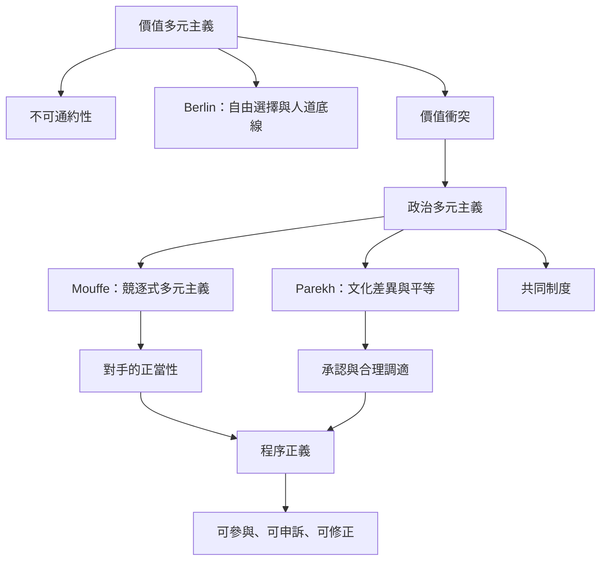

價值多元主義討論多種善如何衝突；政治多元主義討論這些衝突如何進入公共制度。兩者相連，但不能以程序共識取代真實價值損失。

核心概念：[[價值多元主義]]、[[政治多元主義]]、[[不可通約性]]、[[競逐式多元主義]]、[[協商民主]]、[[程序正義]]、[[承認政治]]、[[再分配正義]]。

案例與文獻：[[價值多元主義的核心不是所有價值都能被同一尺度排序]]、[[Chantal Mouffe主張民主應把對手視為合法對手]]、[[Bhikhu Parekh要求政治哲學從文化差異重新思考平等]]。
