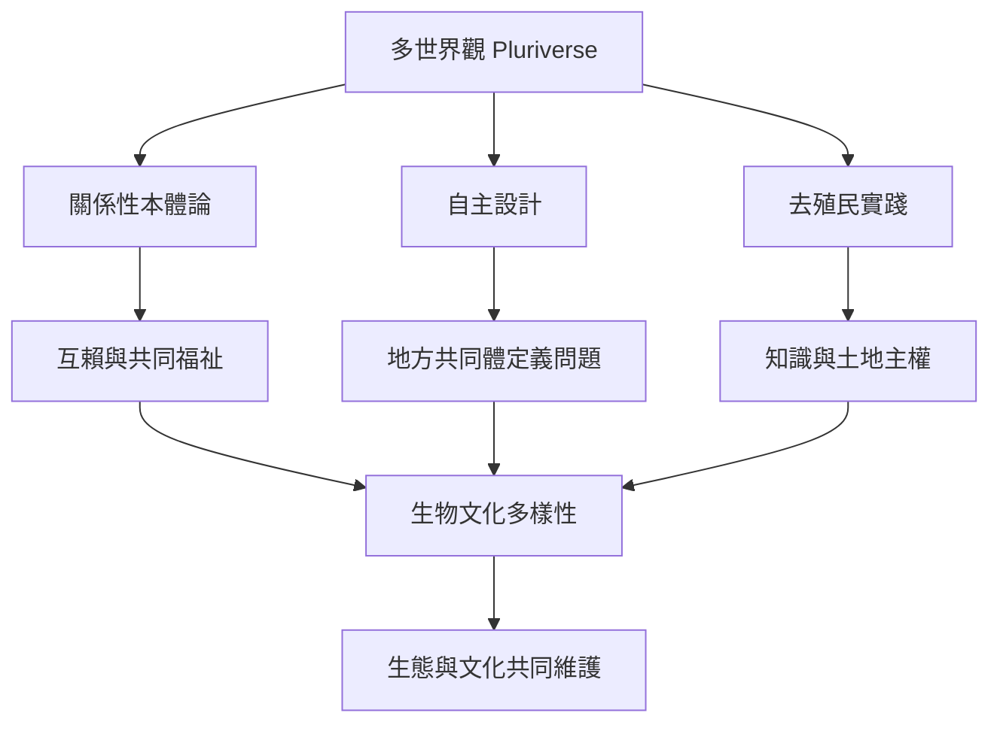

多世界觀把多元主義延伸到存在方式、地方生活與人—自然關係。它要求公共設計不只容納不同身份，也容納不同世界如何被建構與維持。

核心概念：[[多世界觀]]、[[關係性本體論]]、[[自主設計]]、[[Ubuntu]]、[[生物文化多樣性]]、[[原住民族知識系統]]。

重要入口：[[Arturo Escobar以Pluriverse挑戰單一現代世界觀]]、[[南非Ubuntu研究提供以關係與共同福祉重讀權利的方向]]。

可實踐的延伸：[[以多世界設計檢查生活方案對土地與非人生命的影響]]。
