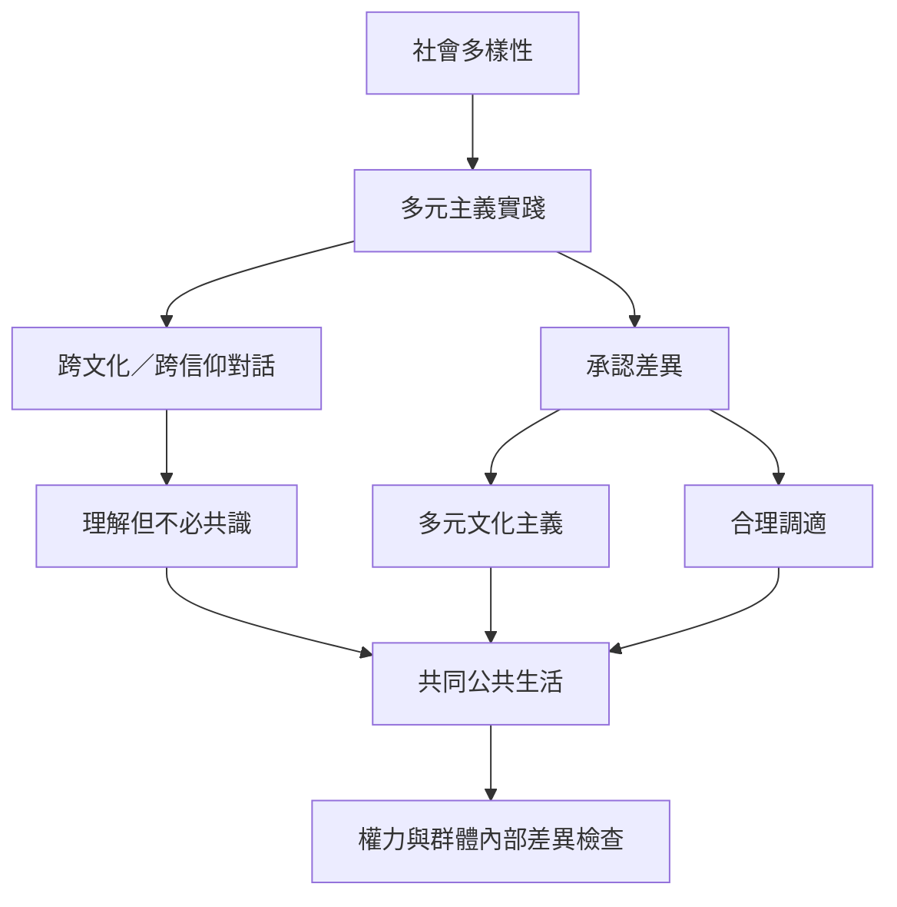

文化與宗教多元需要超越「容忍差異」，進一步建立互相理解、合理調適與共同公共生活。跨文化對話不要求身份融合，也不能掩蓋權力不平等。

核心概念：[[文化多元主義]]、[[多元文化主義]]、[[跨文化主義]]、[[宗教多元主義]]、[[跨文化對話]]、[[跨信仰對話]]、[[承認政治]]、[[合理調適]]。

重要提醒：[[多樣性不會自動形成多元主義]]、[[對話不要求信念合一而要求能理解彼此的差異]]、[[群體自治與群體內部成員權利必須同時檢驗]]。

地區入口：[[台灣的宗教多元可從多重歸屬與公民制度一起理解]]、[[印尼宗教多樣性需要跨信仰關係而不只是人口共存]]、[[加拿大的多元文化與魁北克跨文化主義是兩種不同的整合路徑]]、[[澳洲多元文化主義不能與族群並存或同化混為一談]]。
