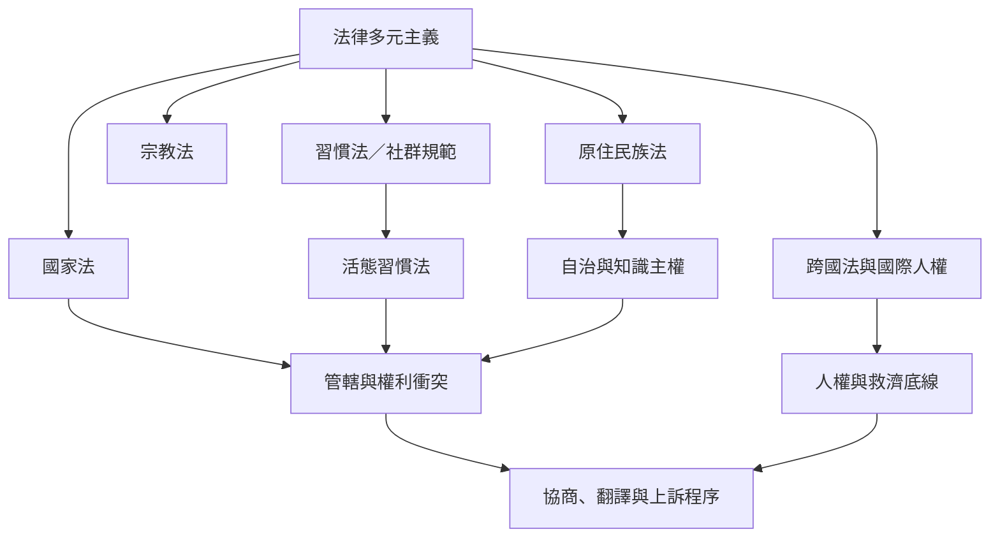

法律多元主義研究多種法律秩序如何在同一社會空間互動。後殖民與原住民族案例顯示，制度承認必須與自治資源、程序、代表性及個人權利一起檢驗。

核心概念：[[法律多元主義]]、[[後殖民法律多元主義]]、[[活態習慣法]]、[[多民族國家]]、[[原住民族知識主權]]、[[程序正義]]。

地區案例：[[玻利維亞的多民族國家實驗揭示自治與發展政策的張力]]、[[厄瓜多的多民族憲政把原住民族司法帶入國家法秩序]]、[[南非案例顯示習慣法的承認需要理解其活態實踐]]、[[紐西蘭法律多元主義把Tikanga Māori視為法律知識來源]]。

檢查原則：[[群體自治與群體內部成員權利必須同時檢驗]]、[[多民族憲政若沒有資源與決策權容易停留於象徵承認]]。
