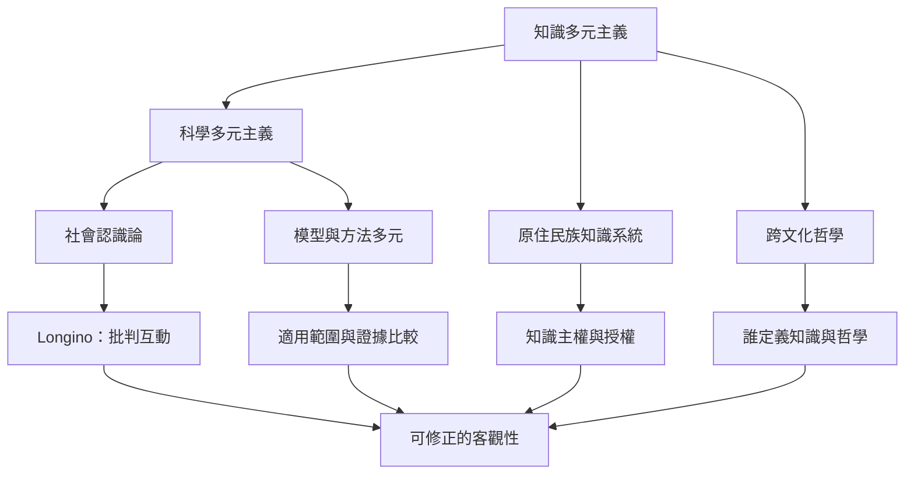

知識多元主義關心不同方法、經驗位置與研究社群如何共同形成可靠知識。多元不是放棄證據，而是讓批判更廣、模型更能回應複雜現象。

核心概念：[[知識多元主義]]、[[科學多元主義]]、[[模型多元主義]]、[[社會認識論]]、[[原住民族知識系統]]、[[原住民族知識主權]]、[[不可通約性]]。

重要文獻：[[科學多元主義把多種模型與方法視為研究資源]]、[[Helen Longino將科學客觀性理解為批判互動的社會成果]]、[[非洲哲學的跨文化取向要求哲學對話承認知識位置]]。
