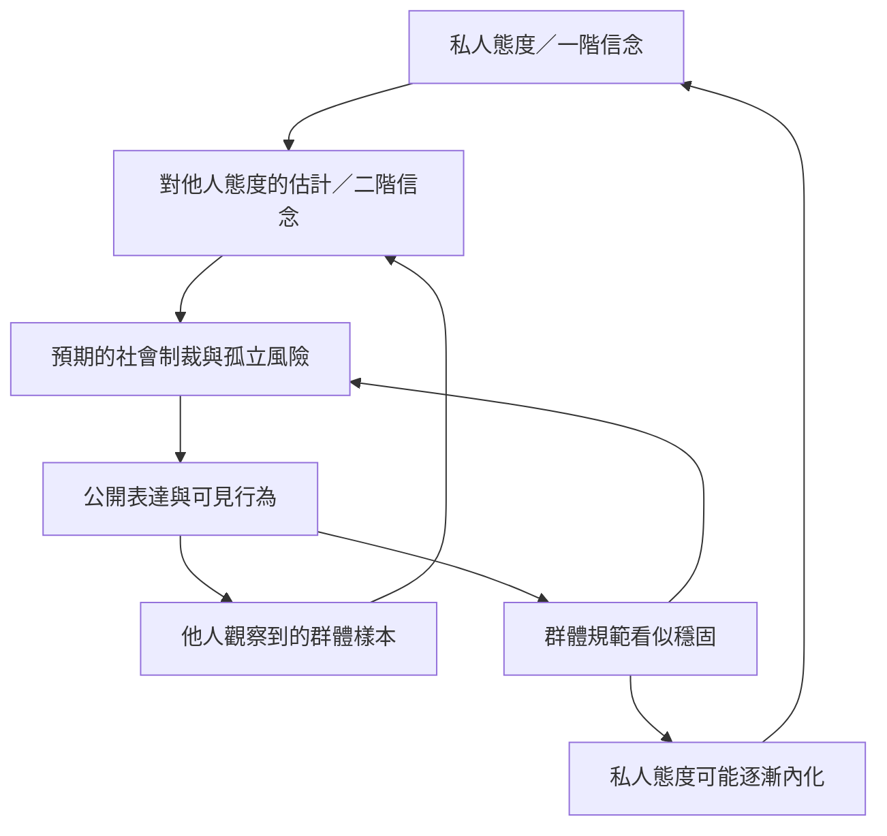

多元無知的基本循環由私人態度、對他人態度的估計、公開表達與可見行為構成。當個人低估他人與自己相同的程度，就可能調整表達或行動；新的公開行為又成為下一輪推論的材料。此循環可在沒有真實共識時維持規範，也可能讓錯認的規範逐漸內化。

## 關係圖

## 相關概念
* [[多元無知是群體層次的自我誤認，而非單人的判斷失誤]]
* [[公開行為不等於私人態度]]
* [[社會規範可以在缺乏真實共識時持續存在]]
* [[描述性規範與命令性規範必須分開測量]]
* [[偏好偽裝與多元無知相互放大卻不是同一概念]]
* [[沉默螺旋會讓錯認的多數意見更加穩固]]
* [[私人態度可能先改變，而群體共識感知仍停留在過去]]
* [[校正多數態度不代表人們就會採取行動]]

## 參考
* [[百年回顧指出多元無知兼有微觀互動與宏觀資訊兩種路徑]]
* [[群體成員錯估彼此態度會讓不受歡迎的規範看似普遍]]
* [[校園飲酒研究顯示錯估群體態度會讓人逐漸接受原本不自在的規範]]
