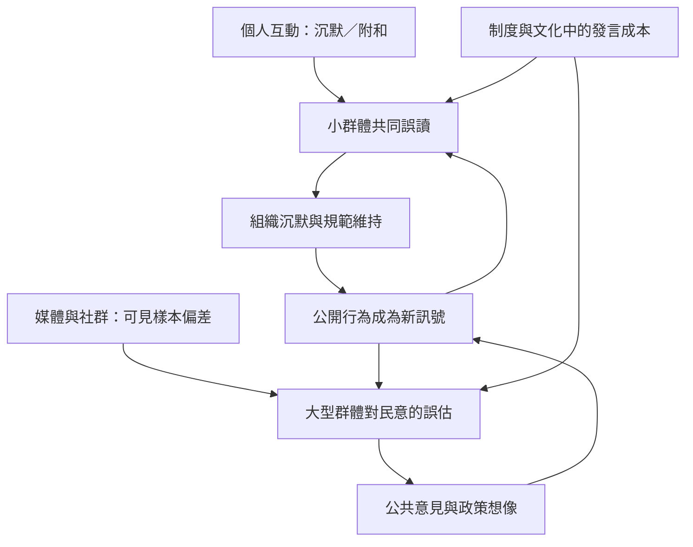

多元無知可發生於小型互動，也可發生於跨地域公共議題。小型群體常因直接觀察到的沉默或平靜而誤讀彼此；大型群體則容易因媒體、平台與可見樣本不具代表性而誤認民意。組織沉默、跨群體接觸停滯與社會規範再生產，都是不同尺度的表現。

## 關係圖

## 相關概念
* [[低互相可觀察度使人們依賴不具代表性的群體線索]]
* [[高互相可觀察情境中的公開行動可能迅速改變群體判斷]]
* [[組織沉默是多元無知可能出現的制度性條件]]
* [[可見樣本的代表性決定群體如何想像自己]]
* [[社會媒體與新聞會放大不具代表性的極端聲音]]
* [[跨群體雙方都可能把對方的沉默誤讀為拒絕]]
* [[文化緊密度會改變規範更新與公開表達的成本]]

## 參考
* [[中國大學生可能高估同儕反日態度而調整公開表達]]
* [[雙方都想接觸卻以為對方不願意會使跨群體關係停滯]]
* [[組織沉默會讓員工把彼此不發言解讀為缺乏問題意識]]
* [[跨十一國與五十五國研究顯示氣候支持常被低估]]
