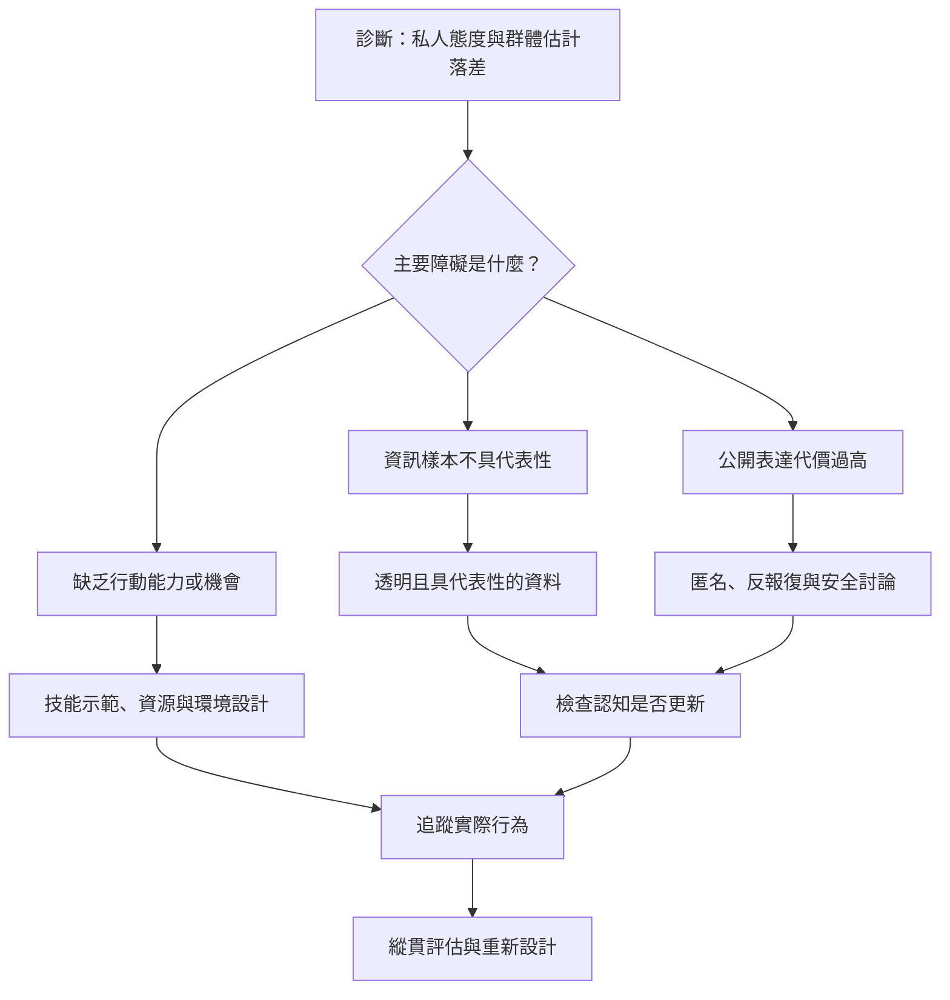

介入多元無知時，公布正確的群體比例只是其中一步。參與者可能不相信資料、無法安全表達、缺乏實際行動腳本，或受到價格、制度與資源限制。有效介入需要診斷偏誤來源，並把資訊校正、降低表達成本、同儕示範、環境改造與實際行為測量結合起來。

## 關係圖

## 相關概念
* [[校正多數態度不代表人們就會採取行動]]
* [[降低發言代價比單純要求勇敢更能打開沉默]]
* [[可見的支持行動比抽象共識訊息更能提供行動腳本]]
* [[測量多元無知必須同時比較私人態度與對群體的估計]]
* [[多元無知的方向會因測量的是態度還是行為而改變]]
* [[文化緊密度會改變規範更新與公開表達的成本]]
* [[荷蘭超市實地研究顯示真實規範資訊未必改變購買行為]]

## 參考
* [[男性盟友研究顯示修正信念不等於提升實際行動]]
* [[荷蘭超市實地研究顯示真實規範資訊未必改變購買行為]]
* [[氣候行動研究發現人們可低估支持卻高估少見行為]]
