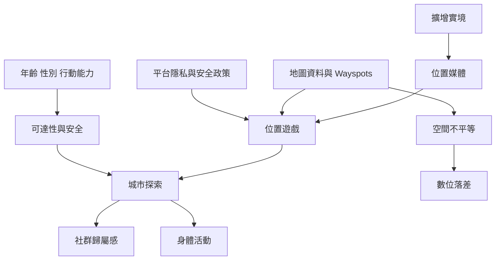

Pokémon GO 把定位、擴增實境與遊戲任務疊加在日常城市空間，可能促進步行、探索與社交；但地圖點位、城市安全、年齡性別差異、個資與設備可及性會決定哪些人真正能受益。

## 思與行
* 評估位置遊戲時，不只問「有沒有增加步數」，還要問誰能安全參與、誰被地圖忽略，以及效益能維持多久。
* 可將遊戲探索路線改造成無手機也能參與的社區步行，並提供座椅、廁所、無障礙與退出安排。
* 延伸概念：[[擴增實境]]、[[位置媒體]]、[[公共空間]]、[[身體活動]]、[[遊戲化]]、[[數位落差]]、[[社群歸屬感]]。

## 參考
* 研究卡片：[[note/寶可夢GO把城市轉成疊加數位目標的混合遊戲空間]]、[[note/位置遊戲能帶來社交機會但公共空間的可達性並不平等]]、[[note/遊戲化可以引導身體活動但不能被誤認為穩定健康治療]]、[[note/位置遊戲的數位地圖會映照既有城市資源不平等]]。
* 來源卡片：[[data/寶可夢GO讓數位遊戲疊合在真實城市路徑上]]、[[data/寶可夢GO的地理資料可能重現城市資源的不平等分布]]、[[data/寶可夢GO的身體活動與心理效益存在族群差異且長期效果仍不確定]]。
