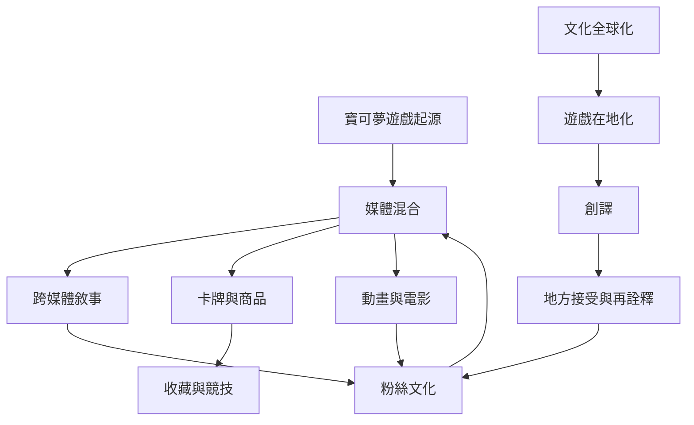

寶可夢從掌機遊戲出發，透過卡牌、動畫、電影、商品、活動與粉絲創作擴張成媒介混合系統。品牌全球化依賴跨媒介互補，也依賴遊戲在地化、授權與地方社群的共同參與。

## 思與行
* 以此圖比較不同媒介的參與方式，並追問品牌擴張是否讓粉絲更有創作空間，或更依賴官方發行節奏。
* 延伸概念：[[寶可夢]]、[[媒體混合]]、[[跨媒體敘事]]、[[遊戲在地化]]、[[創譯]]、[[文化全球化]]、[[軟實力]]、[[粉絲文化]]。

## 參考
* 研究卡片：[[note/寶可夢是一套以收藏為核心的媒介混合系統]]、[[note/全球化的寶可夢必須經過翻譯與文化創譯]]、[[note/日本流行文化的全球流通同時涉及文化吸引力與商業條件]]。
* 來源卡片：[[data/寶可夢以遊戲為起點並在1990年代末拓展成跨媒介品牌]]、[[data/寶可夢的全球成功依賴媒體混合與跨國流通而非單一作品]]、[[data/寶可夢法語譯名透過創譯保留語義動機並適應當地語言]]。
