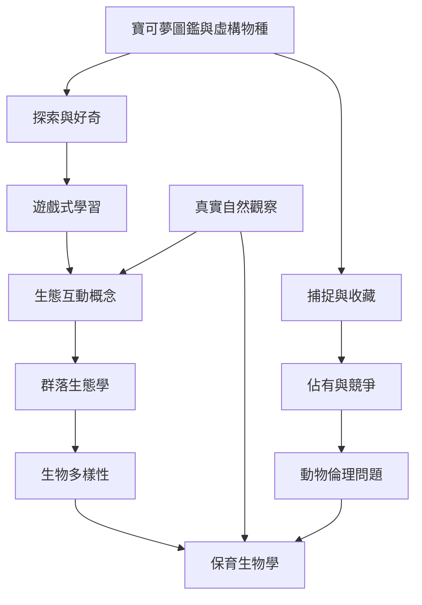

寶可夢以虛構物種與生態互動吸引注意，能成為生物多樣性與群落生態學的教學入口；但捕捉與收藏也將生命轉化為可擁有的對象。生態教育若要延伸到保育，需把遊戲中的好奇心帶回真實棲地與非佔有型觀察。

## 思與行
* 用寶可夢當作引子，不當作科學資料來源；課程要有真實物種、觀察紀錄與可靠資料補充。
* 將遊戲目標從捕捉改成辨識、觀察、記錄、尊重與棲地照護，讓好奇心不必以佔有為終點。
* 延伸概念：[[分類學]]、[[遊戲式學習]]、[[群落生態學]]、[[生物多樣性]]、[[保育生物學]]、[[動物倫理]]。

## 參考
* 研究卡片：[[note/收集圖鑑讓分類知識變成可操作的探索動機]]、[[note/寶可夢可以作為生態教學入口但不能替代真實生態]]、[[note/寶可夢敘事將照護與捕捉競爭放在同一世界觀中]]。
* 來源卡片：[[data/寶可夢角色可被用作講授群落生態互動的遊戲化教材]]、[[data/寶可夢GO可促進自然接觸也可能取代真實自然經驗]]、[[data/寶可夢把自然保育與生物消費並置成為生態文化的矛盾文本]]。
