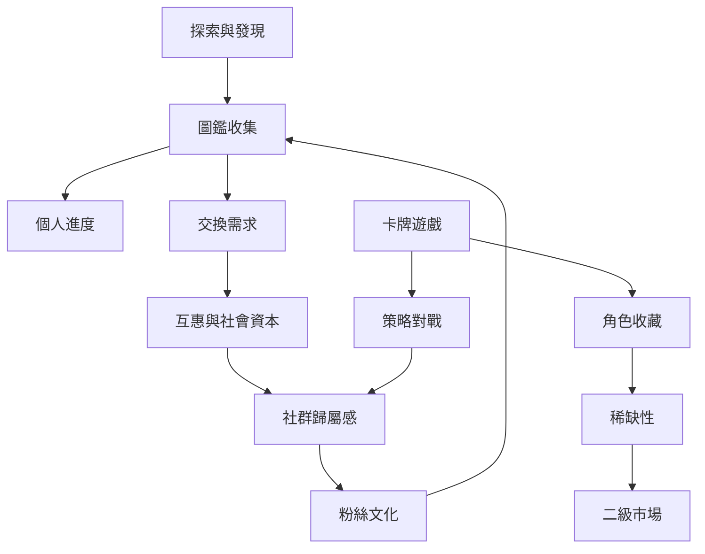

寶可夢的收集機制會透過圖鑑進度形成個人目標，再藉由交換、對戰、卡牌與粉絲社群轉化成社交關係。其社群價值取決於互惠規則、資源分配與不同玩家的參與條件。

## 思與行
* 分析收集與交易時，同時看合作、競爭與權力差異；互惠不應被假設為自動公平。
* 可用此圖設計低門檻卡牌交換活動，讓遊戲、分享與認識新朋友比高價收藏更重要。
* 延伸概念：[[收藏]]、[[互惠]]、[[社會資本]]、[[社群歸屬感]]、[[集換式卡牌遊戲]]、[[稀缺性]]、[[二級市場]]、[[粉絲文化]]。

## 參考
* 研究卡片：[[note/收集圖鑑讓分類知識變成可操作的探索動機]]、[[note/交換機制把個人收集轉成互賴式社交]]、[[note/卡牌稀缺不會單獨決定交易價格]]、[[note/粉絲社群不是市場的被動受眾而是共同維護世界觀的參與者]]。
* 來源卡片：[[data/寶可夢官方將收集培育交換與對戰定義為系列核心]]、[[data/寶可夢卡牌銷售呈現價格偏斜且少數稀有卡貢獻較高收入]]。
