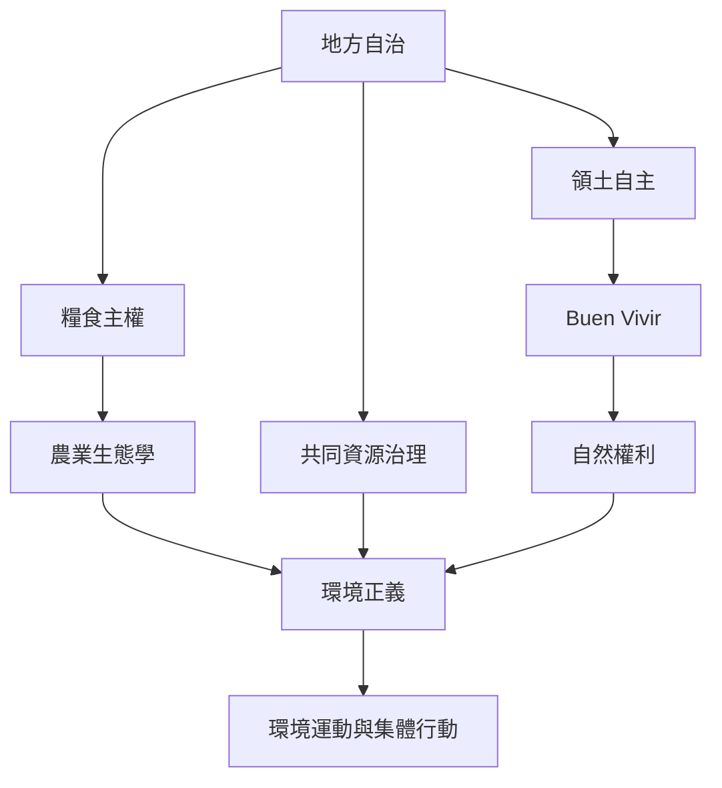

政治生態學不只揭露不平等，也研究社群如何建立替代治理方式。糧食主權、農業生態學、共同資源、自然權利、Buen Vivir 與領土自治都在追問：社群能否共同決定如何生活、如何生產，以及如何與自然建立關係。

## 參考
* [[糧食主權把食物系統的決定權帶回生產者與社群]]
* [[自然權利只有結合社會動員與制度執行才可能改變治理]]
* [[環境衝突也會創造新的集體身份與政治想像]]
* [[把社區共同資源治理做成透明可檢驗的小型實驗]]
* [[以公共餐桌連結糧食主權與地方生態治理]]
* [[糧食主權]]、[[農業生態學]]、[[共同資源]]、[[Buen Vivir]]、[[自然權利]]
